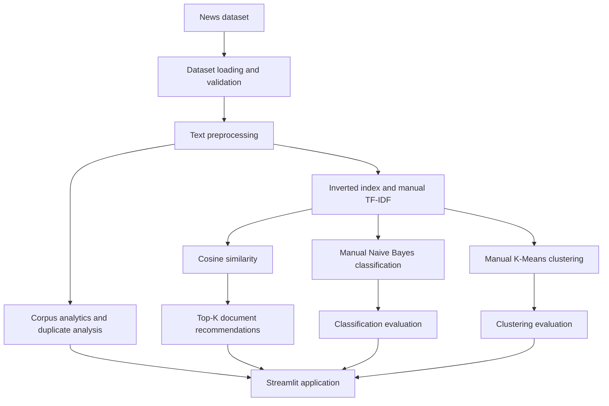

# Text Mining & Document Intelligence System

A Streamlit-based application for exploring a labelled news corpus and performing end-to-end text mining and document analysis. The system brings together text preprocessing, corpus analytics, inverted indexing, manually implemented TF-IDF, document similarity, supervised classification, unsupervised clustering, and content-based document recommendations.

> **Course project:** Information Retrieval — Assignment 2  
> **Repository:** [IR-Text-Mining-Document-Intelligence](https://github.com/2025ag05284-bit/IR-Text-Mining-Document-Intelligence)

## Table of contents

- [Project overview](#project-overview)
- [Objectives](#objectives)
- [Application features](#application-features)
- [System workflow](#system-workflow)
- [Modules and team responsibilities](#modules-and-team-responsibilities)
- [Algorithms and evaluation](#algorithms-and-evaluation)
- [Dataset](#dataset)
- [Installation](#installation)
- [Run the application](#run-the-application)
- [Using the application](#using-the-application)
- [Project structure](#project-structure)
- [Testing and validation](#testing-and-validation)
- [Implementation notes](#implementation-notes)
- [Team contributions](#team-contributions)

## Project overview

The Text Mining & Document Intelligence System processes a collection of news articles and makes the resulting corpus searchable and analyzable. It provides a graphical interface where a user can inspect the dataset, configure text preprocessing, examine term statistics, classify articles, explore clusters, and find articles similar to a selected document.

The project is organized into reusable Python modules and Streamlit pages. The intended design is to share one consistent document collection and one consistent TF-IDF feature representation across the information-retrieval, classification, clustering, and recommendation components.

## Objectives

1. Ingest and validate a collection of labelled news documents.
2. Clean and preprocess document text for analysis.
3. Analyze corpus statistics, vocabulary, duplicates, and term distributions.
4. Build an inverted index and calculate TF-IDF features without relying on a prebuilt TF-IDF estimator.
5. Classify documents with a manually implemented Naive Bayes classifier.
6. Cluster documents with a manually implemented K-Means algorithm.
7. Evaluate classification and clustering results using appropriate metrics.
8. Recommend the most similar documents using cosine similarity over TF-IDF vectors.
9. Present the workflow and results through an interactive Streamlit application.

## Application features

### 1. Dataset and corpus analytics

- Load the news dataset and inspect document fields.
- Validate required fields and document identifiers.
- Review corpus-level statistics and vocabulary information.
- Inspect exact and near-duplicate analysis where available.

### 2. Text preprocessing

The preprocessing workflow can include:

- Lowercase conversion
- Tokenization
- Stop-word removal
- Stemming and/or lemmatization
- N-gram generation
- Comparison of preprocessing configurations

The options available in the application depend on the selected preprocessing configuration and the installed NLP resources.

### 3. Information retrieval and feature engineering

- Construct an inverted index that maps terms to the documents in which they occur.
- Calculate term frequency (TF) and inverse document frequency (IDF) manually.
- Generate TF-IDF document vectors using a shared vocabulary and feature ordering.
- Calculate cosine similarity between document vectors.
- Inspect important terms and feature statistics.

### 4. Document classification

- Split labelled documents into training and testing subsets.
- Train a Multinomial Naive Bayes classifier implemented in the project.
- Use Laplace smoothing when estimating word likelihoods.
- Predict category labels for test documents.
- Report accuracy, precision, recall, F1-score, and a confusion matrix.

### 5. Document clustering

- Cluster TF-IDF document vectors using a project-implemented K-Means algorithm.
- Assign each document to a cluster and update centroids iteratively.
- Inspect cluster sizes and document assignments.
- Evaluate clustering against known labels using Purity and Rand Index.
- Use a dimensionality-reduction view for plotting only, where enabled; this does not replace the K-Means implementation.

### 6. Document recommendations

- Select a document from the corpus.
- Retrieve the top-*K* most similar documents using cosine similarity over TF-IDF vectors.
- Display the recommended document ID, title, category, and similarity score.
- Exclude the selected document and filter repeated/duplicate articles where duplicate metadata is available.
- Download recommendation results as a CSV file, where enabled in the page.

## System workflow



## Modules and team responsibilities

The project is divided into five technical workstreams:

| Team member | Responsibility | Main output |
|---|---|---|
| Person 1 | Dataset ingestion, validation, preprocessing, corpus analytics, and duplicate analysis | Dataset and preprocessing components |
| Person 2 | Inverted index, manual TF-IDF, and cosine similarity | Retrieval and feature-engineering components |
| Person 3 | Manual Multinomial Naive Bayes and classification evaluation | Classifier, predictions, and classification metrics |
| Person 4 | Manual K-Means and clustering evaluation | Cluster assignments, Purity, and Rand Index |
| Person 5 | Content-based recommendations, Streamlit integration, documentation, and final application checks | Recommendation component, integrated UI, and README |

All team members should contribute to testing, interpretation of results, report writing, and the final demonstration.

## Algorithms and evaluation

The assignment requires the core algorithms below to be implemented in the project rather than delegated to ready-made machine-learning estimators.

| Component | Approach | Main output |
|---|---|---|
| Inverted index | Build term-to-document postings from processed documents | Postings for indexed terms |
| TF-IDF | Calculate TF, IDF, and weighted document vectors in project code | Document-term matrix and vocabulary |
| Similarity | Cosine similarity between TF-IDF vectors | Similarity score for a document pair |
| Classification | Multinomial Naive Bayes with Laplace smoothing | Predicted document category |
| Classification evaluation | Accuracy, precision, recall, F1-score, and confusion matrix | Classification performance |
| Clustering | K-Means with centroid initialization, assignment, and update steps | Cluster label for each document |
| Clustering evaluation | Purity and Rand Index | Agreement between clusters and reference labels |
| Recommendation | Rank other documents by cosine similarity | Top-*K* similar documents |

### Important implementation constraint

Libraries such as NumPy and pandas may be used for data handling and numerical operations. However, the required Information Retrieval and machine-learning algorithms (including TF-IDF, Naive Bayes, K-Means, Purity, and Rand Index) must remain implemented in the project code in accordance with the assignment instructions. Do not replace these implementations with calls to prebuilt scikit-learn estimators.

## Dataset

The project is designed around a labelled news dataset (the team has been using BBC news articles). Each record should represent one document and should contain, at minimum, fields equivalent to:

| Field | Description |
|---|---|
| `document_id` | Unique identifier for the article |
| `title` | Article headline |
| `text` | Original article text |
| `category` | Reference news category/label |

Additional fields such as publication date or source may be retained when they are available in the dataset.

### Dataset requirements

- Each document must have a unique, stable ID.
- The category field should be populated for supervised classification and external clustering evaluation.
- Empty or malformed text records should be handled before feature generation.
- The same document ordering must be preserved when passing metadata and TF-IDF rows to classification, clustering, and recommendation components.
- Keep the original dataset and generated/processed data separate where practical.

**Dataset attribution:** Add the exact dataset download/source URL and any required license or attribution statement here before submission. The source URL and license should match the specific copy used by the team.

## Installation

### Prerequisites

- Python 3.10 or a Python version supported by the dependencies in `requirements.txt`
- Git
- A terminal (or the integrated terminal in VS Code)

### 1. Clone the repository

```bash
git clone https://github.com/2025ag05284-bit/IR-Text-Mining-Document-Intelligence.git
cd IR-Text-Mining-Document-Intelligence
```

### 2. Create and activate a virtual environment

**macOS / Linux**

```bash
python3 -m venv .venv
source .venv/bin/activate
```

**Windows (PowerShell)**

```powershell
py -m venv .venv
.venv\Scripts\Activate.ps1
```

### 3. Install dependencies

```bash
python -m pip install --upgrade pip
pip install -r requirements.txt
```

If the preprocessing workflow uses NLTK resources that are not already installed, download the resources requested by the application or listed in the project setup instructions.

## Run the application

From the repository root, with the virtual environment activated:

```bash
streamlit run app.py
```

Streamlit will print a local URL in the terminal (normally `http://localhost:8501`). Open that address in a browser. Stop the application with `Ctrl+C` in the terminal.

## Using the application

A typical workflow is:

1. Open the application and load or select the news dataset.
2. Review the dataset and corpus overview.
3. Choose preprocessing options and inspect the processed text and corpus statistics.
4. Open Feature Engineering to build or inspect the inverted index and TF-IDF representation.
5. Open Classification to train/evaluate Naive Bayes and inspect the classification report.
6. Open Clustering to run K-Means and inspect cluster assignments and clustering metrics.
7. Open Document Recommendations, select an article, choose *K*, and retrieve similar articles.
8. Export available results and capture the required screenshots for the assignment report.

Some pages may require an earlier page or setup step to initialize shared data/model state. If a page reports that the dataset or TF-IDF model is unavailable, return to the relevant setup/feature-engineering page and complete that step first.

## Project structure

The repository is organized into an application entry point, reusable modules, Streamlit pages, data, and result artifacts. The exact filenames may evolve as team branches are merged.

```text
IR-Text-Mining-Document-Intelligence/
├── app.py                  # Streamlit application entry point
├── data/                   # Raw and/or processed dataset files
├── modules/                # Reusable dataset, NLP, retrieval, ML, and recommendation logic
│   ├── inverted_index.py   # Inverted index implementation
│   ├── tfidf.py            # Manual TF-IDF implementation
│   ├── similarity.py       # Cosine similarity and top-K retrieval
│   └── recommendation.py   # Recommendation wrapper and metadata mapping
├── pages/                  # Streamlit pages for the project modules
├── results/                # Generated experiment and evaluation results
├── screenshots/            # Screenshots for documentation/report (if maintained)
├── requirements.txt        # Python dependencies
└── README.md               # Project documentation
```

Classification, clustering, preprocessing, and dataset files are maintained in the relevant module/page locations in the repository; consult the current tree for their exact filenames.

## Testing and validation

Run the available project tests from the repository root. For example, if the TF-IDF test file is present:

```bash
python -m pytest
```

If the repository uses standalone test scripts instead of pytest, run the documented script directly (for example, `python test_tfidf.py`).

Before submission, verify at least the following:

- The application starts from a clean terminal session.
- The dataset loads and document IDs are unique.
- Preprocessing handles empty text and missing values safely.
- TF-IDF rows align with the document metadata and vocabulary ordering.
- Classification metrics are calculated from held-out predictions.
- K-Means terminates and returns one cluster assignment per document.
- Purity and Rand Index are calculated from the reference labels and cluster assignments.
- Recommendations exclude the selected article and do not repeat the same article when duplicate information is available.
- Top-*K* recommendations are ordered by descending similarity score.
- Every page can be opened without an unhandled exception.

## Implementation notes

### Keep document ordering consistent

A row in the TF-IDF matrix must always refer to the same document as the corresponding row in the metadata table. If the dataset is filtered, sorted, or reset, apply the same operation to both. This is especially important for document recommendation, which maps the indices returned by the similarity module back to article titles and categories.

### Avoid duplicate recommendations

The recommendation feature should exclude the selected document itself. Where the metadata contains the original article text, duplicate article content should also be filtered so that a repeated copy with a different document ID is not recommended. If original text is unavailable, title-based matching is a fallback and is less reliable.

### Interpret similarity scores correctly

Cosine similarity is a ranking score based on vector orientation. A score such as `0.1820` is not an 18.2% probability, confidence, or classification accuracy.

### Reproducibility

Record the dataset version, preprocessing settings, train/test split, random seed (if configured), number of clusters, and other experiment settings in the assignment report. Performance values can change when these settings or the input corpus change; do not treat one screenshot's metric values as universal results.

## Team contributions

| Role | Name / GitHub username | Contribution                                                         |
|---|------------------------|----------------------------------------------------------------------|
| Person 1 | Mubeena                | Dataset, preprocessing, dataset experimentation and corpus analytics |
| Person 2 | Aman Verma             | Inverted index, TF-IDF, and cosine similarity                        |
| Person 3 | Reshma Sri Mullapudi   | Naive Bayes classification and metrics                               |
| Person 4 | Asutosh Kumar          | K-Means clustering and clustering metrics                            |
| Person 5 | Aditya Saraswat        | Recommendation system, Streamlit integration, and documentation      |

Update this table with the actual names/usernames and verify the contribution descriptions before final submission.

---

**Academic note:** This repository is an assignment project. Reported metrics and screenshots should be generated by running the submitted code on the stated dataset and configuration. Clearly identify any limitations, experimental settings, and external resources used.
